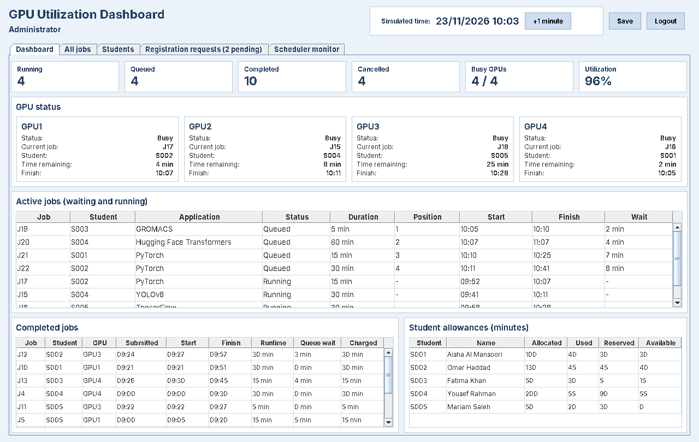

# GPU Utilization Dashboard - COSC 230 Project

A Java Swing application that manages four simulated NVIDIA H100 GPUs. Students register,
the administrator approves accounts and allocates GPU minutes, approved students submit jobs,
and one first-come-first-served (FCFS) queue runs the jobs on the GPUs as the simulation clock
advances. Everything is saved to text files and restored after a restart.



## Requirements

- JDK 8 or newer (tested with JDK 21, compiled with `--release 8`). No external libraries.
- Eclipse (any recent version), or a terminal.

## Run in Eclipse

1. **File > Import > General > Existing Projects into Workspace** and select this folder
   (it contains `.project`).
2. Open `src/MainApp.java` and choose **Run As > Java Application**.
3. The first time, the system starts empty: no students, no jobs, and the clock not yet started.
4. Log in as the administrator `admin` / `gpu2026` (predefined). Students register on the
   login page and can log in once the administrator approves them.

Eclipse runs the program in the project folder, so the data is saved in `data/` inside it.
Delete the `data` folder to start from scratch again.

## Run from a terminal

```
javac -d bin src/*.java
java -cp bin MainApp                 # start the application (data folder: ./data)
java -cp bin SystemTests             # complete system tests (123 checks)
java -cp bin SchedulerTests          # scheduler tests (38 checks)
```

`java -cp bin MainApp otherFolder` uses another data folder.

## Getting started (from an empty system)

| Step | How |
|---|---|
| Register students | On the login page choose **Register**, fill in university ID, name, email, phone and password. Each registration becomes a pending request. Registering the same ID twice is refused. |
| Approve | Log in as `admin` > **Registration requests** > type the ID in *Request ID* > **Approve** (100 minutes by default; change *Initial minutes* to adjust) or **Reject**. |
| Start the clock | Still as `admin`: pick the start date and time at the top and press **Start clock** (once). After that only **+1 minute** moves the time. |
| Submit jobs | Log in as a student > **Submit and manage jobs**: title, application, description and task size (Small 5, Medium 15, Large 30, Very large 60 minutes), then confirm the duration. The full duration is reserved from the allowance; a job longer than the minutes available is refused, an exact match is accepted. |
| Watch the queue | Administrator **Dashboard**: GPU status, waiting and running jobs with position, predicted start, finish and wait. Students see the same for their own jobs in **Queue status and results**. With all four GPUs busy, new jobs wait in FCFS order. |
| Advance Minute | Press **+1 minute**: running jobs progress, finished jobs complete (runtime charged once), the next waiting jobs start on the free GPUs (lowest GPU number first). |
| Cancel | Student: select a job > **Cancel Job** > reason (queued: no charge; running: the minutes it ran are charged). Administrator: **All jobs** > select a job > **Cancel selected job** > reason. |
| Extra time | **Students** > select a student > *Extra minutes* and *Reason* > **Grant**. The grant is kept in the allowance history. |
| Search | **Students**: search by university ID. **All jobs**: search by job number (`12` or `J12`), student, title, application, ... plus a status filter. Students search their own jobs only. |
| Save and reload | Close the window and start `MainApp` again: the clock, GPUs, remaining runtimes, queue and balances are the same. The simulated time does not move while the program is closed. |

## How it works

| Area | Classes | Author |
|------|---------|--------|
| Accounts and registration | `User` (abstract), `Student`, `Administrator`, `AccessRequest`, `AccountManager`, `AccountException`, `AccountsGUI` | Person 1 |
| Jobs and allowances | `Job`, `JobManager`, `TimeAllowance`, `StudentDashboardPanel` | Person 2 |
| Scheduler and clock | `Scheduler`, `GPU`, `SimulationClock`, `QueuePrediction`, `SchedulerListener` (interface), `SchedulerMonitorPanel`, `SchedulerDemo`, `SchedulerTests` | Person 3 |
| Storage, main GUI and integration | `MainApp`, `MainFrame`, `GpuSystem`, `IntegratedJobManager`, `SystemChangeListener` (interface), `StorageManager`, `StorageException`, `JobInfo`, `ClockPanel`, `AdminDashboardPanel`, `AdminJobsPanel`, `AdminStudentsPanel`, `StudentQueuePanel`, `UiStyle`, `SystemTests` | Person 4 |

- **`MainFrame` extends `AccountsGUI`**: it reuses the login, registration and request screens
  and overrides `showAccount()` to open the administrator area (Dashboard, All jobs, Students,
  Registration requests, Scheduler monitor) or the student area (Submit and manage jobs,
  Queue status and results).
- **`IntegratedJobManager` extends `JobManager` and implements `SchedulerListener`**: an accepted
  job joins the scheduler's FCFS queue; a cancellation goes through `JobManager`'s rules and then
  removes the job from the queue or frees its GPU; a completion settles the allowance once.
  `StudentDashboardPanel` uses it without changes (polymorphism).
- **`GpuSystem`** is the single object the screens talk to (interface code is kept separate from
  the domain logic). It saves the data after every change and notifies the screens through the
  `SystemChangeListener` interface so they refresh.
- **Only the administrator** can start the clock (date and time pickers, once) and press
  **+1 minute** (Advance Minute).

The small changes made to the other members' files while connecting the parts are listed in
[`docs/integration-notes.md`](docs/integration-notes.md).

Class diagrams (attributes and methods) are in [`docs/class-diagram`](docs/class-diagram):
`0-overview` shows every class and relationship; `1`-`6` show each area in detail
(PNG for reading, SVG for zooming, `.puml` sources).

## Data files

| File | Contents | Written by |
|------|----------|------------|
| `data/accounts.txt` | registration requests (pending, approved, rejected) and approved accounts | `AccountManager` |
| `data/simulation.txt` | clock, GPU assignments, allowances and their history, jobs, cancellations | `StorageManager` |

- No data is included: the files are created the first time something is saved.
- The data is saved automatically after every change (and by the **Save** button and when the
  window closes). A temporary file is written first and then replaces the old file, so a failed
  save never leaves a half-written file.
- `simulation.txt` is plain text with one section per kind of data (`[CLOCK]`, `[GPUS]`,
  `[ALLOWANCES]`, `[ALLOWANCE_HISTORY]`, `[JOBS]`, `[CANCELLATIONS]`). Text fields are escaped
  (`\p` = `|`, `\n` = new line), so any title or reason can be stored.
- On start-up the whole file is checked before anything is restored: field formats, job states,
  GPU assignments, and that every balance matches its jobs. A problem is reported with the file
  name, line number and reason, and the program offers to keep the damaged file as a backup and
  start again without it.

## Tests

- `SystemTests` (123 checks): accounts and approval, clock rules, allowance rules (reservation,
  exact match, zero balance, settle once, queued and running cancellations, permissions),
  FCFS order and GPU order, the example dashboard from the project brief (waits 5 and 10 minutes),
  waits after advances and cancellations, utilization, save/reload round trips, identical
  behaviour after a restart, special characters, damaged files, 97 random restarts, search
  and a full test scenario (5 students, 22 jobs in every state) built in a temporary folder.
- `SchedulerTests` (38 checks): the scheduler on its own.

Both suites use temporary folders, so they never change `data/`. The latest results are in
[`docs/test-results.md`](docs/test-results.md).
